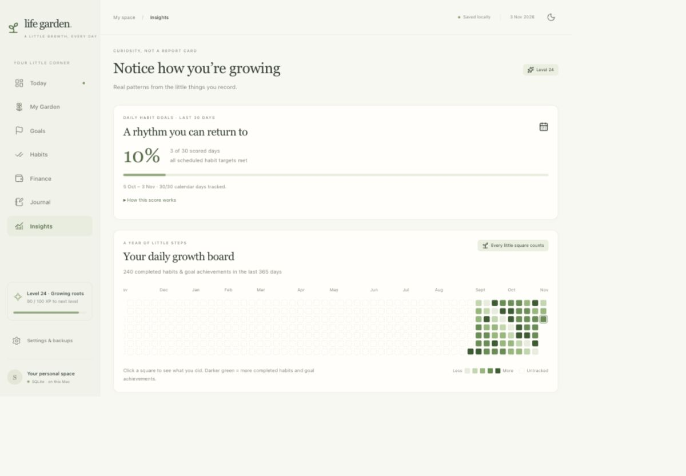

# Life Garden 🌱

A private personal life dashboard: **compound what matters, simplify everything else.** Built with Next.js, TypeScript, Tailwind, Lucide, Recharts, and local SQLite. No cloud account or paid API is needed.



_Preview uses a separate synthetic test dataset; new installations contain no completed history._

## Run on your Mac

Use Node.js 22.13+ (an active LTS version is recommended).

```sh
git clone https://github.com/pangshengwei/life-garden.git
cd life-garden
npm install
npm run dev
```

Open [Life Garden](http://127.0.0.1:3000). Keep the terminal running; press Control-C to stop. For the production build:

```sh
npm run build
npm start
```

The server binds to loopback and the data API accepts local, same-origin requests. This first version is for this Mac. Phone access and hosted access need a later authenticated deployment; a responsive layout alone does not provide cross-device sync.

## Your data

**SQLite is the source of truth.** The default database is `data/life-garden.sqlite`. All application changes use transactions. A versioned JSON document and relational tables update together, keeping backups, schedule history, and SQL exploration consistent.

Tables: `daily_notes`, `habits`, `habit_logs`, `goals`, `financial_snapshots`, `focus_sessions`, `goal_events`, and `app_state`. `habits.revisions_json` preserves historical schedule/target revisions. `habit_logs.excused` identifies recovery days. The complete document in `app_state` also holds settings and the in-progress focus timer.

The app saves shortly after changes. Wait for **Saved locally** before closing. It warns when closing with unsaved changes. If a second tab has changed the database, the stale tab cannot overwrite it: export unsaved edits and reload. A failed Obsidian mirror displays a warning while the SQLite save remains durable.

Use **Settings & backups → Export full backup** to download JSON, and **Restore a JSON backup** to validate and restore it. Export your current data before restoring another backup. Habit CSV export is also available. The JSON backup includes all application data; Obsidian-only personal annotations should be backed up with your vault.

`data/` and environment files are excluded from Git. SQLite and generated Markdown are local files, not encrypted files. If you back up the SQLite file directly, stop the app first or use SQLite's backup command; do not copy just the main file while WAL writes are active.

## Obsidian

Until you choose an existing vault, the app mirrors records into:

```text
data/obsidian/Life Garden/
  Life Garden.md
  Daily.base
  Goals.base
  Habit history.base
  Daily/
  Areas/
  Goals/
  Habits/
  Habit logs/
  Finance/
  Focus/
  Goal progress/
```

You can open `data/obsidian` as a vault to inspect this first. To use an existing vault, create `.env.local` in the project root:

```dotenv
OBSIDIAN_VAULT_PATH="/absolute/path/to/your/Obsidian vault"
```

Restart the app, then open the dashboard. Life Garden writes only to the vault's dedicated **Life Garden** subfolder. It does not require an Obsidian plugin. Open the `.base` files for tables, sorting and filters; the notes also contain YAML properties and internal links for Obsidian's graph. Habit log properties include date, category, actual value, target, completion and excused status.

This is a **one-way mirror**. Edit generated records and properties in Life Garden. Write extra thoughts below the generated block in each note's **Personal notes** section; that section is preserved. Files without the Life Garden marker are never overwritten. Generated fields above the marker are replaced on sync. Bases are only created when missing, so you may customise their views.

Restoring an older backup does not delete vault files. Records no longer in SQLite can remain in Obsidian; old mirror notes are retained intentionally to protect annotations. This means Obsidian may include historical files absent from the restored app. Changing vault paths leaves the old mirror intact.

Optionally relocate all private app data with `LIFE_GARDEN_DATA_DIR` (absolute path). See `.env.example`. Keep SQLite outside a vault that is synchronised live by a file-sync service; the Markdown mirror is the suitable synchronisation surface.

## What works

- Today: Singapore date/time, one priority and first step, plan tomorrow, quick journal, mood and energy, scheduled habits, and bedtime intentions.
- Focus: 25/60/90-minute sessions, pause/resume, focus mode, persisted deadlines, and outcome notes on completion or early finish.
- Habits: create, rename/edit, remove and restore directly from the daily list; yes/no, counts, minutes and numeric targets; editable weekdays; pause; weekly history; historical corrections; excused recovery days. Edits and removal apply from today, leaving earlier schedules and logs intact. Removal is reversible through **Removed habits**; restoring resumes the habit from today without backfilling the removed period.
- Goals: annual/quarterly/monthly/weekly horizons, qualitative 0/1 outcomes, numeric progress, dependencies, due dates, status, editing and archive/restore.
- Garden: six life areas, related goals/habits, outcome progress, activity counts, XP, levels and an original animated plant.
- Journal: calendar browsing, morning notes, evening prompts, editable weekly reflections, tomorrow planning and actual overnight sleep records on the wake-up date.
- Finance: dated manual snapshots, liquid wealth with/without SRS, restricted SRS, net worth, optional securities/property/contribution amounts, allocation, FIRE progress and growth charts after two snapshots.
- Insights: a GitHub-style daily board, rolling 30-day habit-goal hit rate, explained weekly consistency, completion trends, balanced activity counts, and earned badges. There are no invented historical habit completions.
- Responsive layout, light/dark themes, keyboard labels, native modal focus containment and reduced-motion support.

Fresh clones start with generic aspirational goals, configurable habits, and no financial snapshots or completed activity. Your personal balances, employer/project context, name, journal notes and exported backups belong in the ignored local data directory, not the published source. Existing local databases keep their personal goals and snapshots when the app is upgraded. Financial goals and snapshots are edited independently so an old snapshot cannot silently overwrite a newer goal update.

## Scores and interpretation

### Daily growth board

Habits and Insights show a rolling 365-day contribution calendar. Each square opens that date's scheduled habits, completed and excused targets, goal progress, focus outcomes, intention and journal notes. Arrow keys move between squares; Enter/Space opens a day. On mobile, scroll the board horizontally; it opens at the most recent days.

Colour intensity counts **completed scheduled habits + goals newly marked achieved on that date**: 0, 1, 2–3, 4–6, or 7+ completions. Empty tracked days and dashed untracked days are visually distinct. Goal edits record dated events from this version onward. Older achieved goals are not assigned invented dates. Multiple updates to one goal on one day count at most once; a same-day correction away from achieved removes that achievement from the square.

### Rolling 30-day daily habit score

The window is today and the previous 29 Singapore dates. A day is **hit** only when every scheduled, non-excused habit meets its own target. Weekly habits are included on their scheduled days. The percentage is `hit days / scored days × 100`.

Days before tracking began, dates with no scheduled habits, and fully excused or paused days are excluded from the denominator. Missing records after tracking began count as unfinished. Today is included and can still improve. The UI shows both the scored-day denominator and the number of calendar days tracked, so a new garden is never presented as having 30 days of evidence. An empty denominator displays a dash. Goal achievements affect square colour but not this habit-only percentage.

### Weekly consistency and XP

Weekly consistency = completed scheduled habits / scheduled habits × 100, from Monday through today and no earlier than tracking began. Future, paused and excused habits are excluded. Today's unfinished habits are opportunities, not failures.

XP: scheduled habit completion +10; evening reflection with a win and lesson +15; weekly reflection +20; first focus session of at least one minute on a date +20; achieved goal +30. Every 100 XP adds a level. Corrections and undone completions recalculate XP; missing a day does not deduct XP. New installations start at zero XP.

Hours and completions measure activity, not impact. Record evidence in your goal and focus outcome notes. Sleep/energy comparisons remain a future enhancement; this version displays honest data counts rather than inferred relationships. Financial balance changes minus recorded contributions are labelled residual changes, not pure investment gains.

## Verification

```sh
npm run typecheck
npm test
npm run build
```

Domain/storage tests use temporary databases and do not mutate your garden. See `docs/VERIFICATION.md` for browser checks and current limits.

## Architecture and next steps

`src/lib/model.ts` and `activity.ts` contain domain rules; `database.ts` owns SQLite transactions and its relational projection; `obsidian.ts` writes the Markdown mirror; `validation.ts` validates incoming data and restores; `use-garden.ts` serialises browser saves with revision protection. React views live in `src/components`; the local server boundary is `src/app/api/state/route.ts`.

A later Supabase/Postgres adapter can replace this server boundary without rewriting the views or domain rules. Next milestones: authenticated personal/mobile access, explicit two-way Obsidian conflict resolution if desired, richer sleep/energy outcome comparisons, and more custom achievement rules. This MVP does not create reminders or change your existing ChatGPT accountability schedule.
